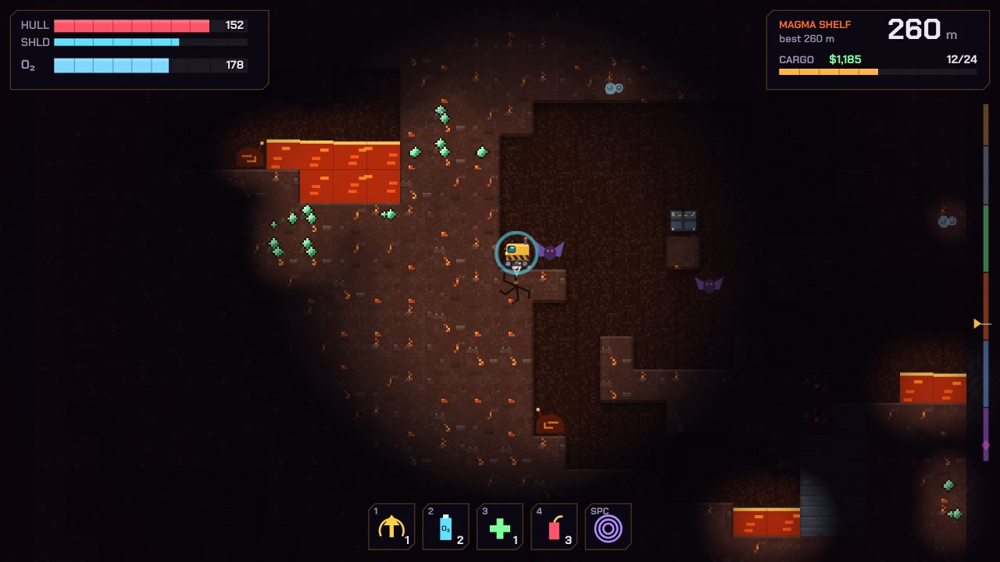

# Deep Core

**A vertical extraction roguelike.** Drill down through shifting, hazardous strata to unearth rare ore, keep an eye on your oxygen, and haul your cargo back to the surface before the rock — or whatever lives in it — gets you. Every dive is a freshly generated shaft; your rig's upgrades are the only thing that carries over.



Plain HTML5 canvas and JavaScript modules. No dependencies, no build step, no image or sound files: the art is generated procedurally at startup and the sound effects are synthesised with Web Audio.

## Play

```bash
npm start            # serves the game at http://localhost:8080
```

Any static file server works (`python3 -m http.server` too). ES modules don't load over `file://`, so opening `index.html` directly won't work. Because it's a static site, GitHub Pages can host it straight from the repository root.

### Controls

| Keys | Action |
| --- | --- |
| `←` `→` `↓` (or `A` `D` `S`) | Drive, and drill whatever is in the way |
| `↑` (or `W`) | Thrusters: climb, hover (hold), and drill upward |
| `Space` | Pulse emitter: a shockwave that damages and repels hostiles and disperses gas |
| `1` `2` `3` `4` | Evac beacon · O₂ canister · patch kit · blast charge |
| `Esc` / `P` | Pause (you can abandon the dive from here) |
| `M` | Mute |

On touch screens an on-screen d-pad appears, and the supply/pulse buttons on the HUD are tappable.

## How a run works

1. **The outpost.** Spend credits on permanent rig upgrades, stock up on supplies, and pick a survey contract for the next dive.
2. **The dive.** Drill down from the surface. Ore goes into your cargo bay. Oxygen drains the whole time — faster while drilling or thrusting, faster with depth, and much faster in the heat of the deep layers. Air pockets in the rock refill it.
3. **Extraction.** Fly back out of the top of the shaft (or light an evac beacon) to sell your cargo. If the rig is destroyed or runs out of air below, the cargo and every supply aboard are lost.

### The strata

| Depth | Layer | Drill needed | Ore | Dangers |
| --- | --- | --- | --- | --- |
| 0–50 m | The Crust | Mk I | Copper, iron | Burrow grubs, loose boulders |
| 50–120 m | Shale Depths | Mk II | Silver, gold | Gloomwings, gas pockets, strata shifts |
| 120–200 m | Fungal Hollows | Mk II | Gold, lumenite | Sporelings (they spit), spore pods, huge caverns |
| 200–280 m | Magma Shelf | Mk III | Ruby, lumenite | Lava, heat drain, magma slugs |
| 280–360 m | Crystal Abyss | Mk IV | Sapphire, diamond | Shardmite swarms, lava, frequent shifts |
| 360 m+ | The Core | Mk V | Voidglass, coreshard | Core Wardens that phase through rock, extreme heat |

**Shifting strata.** From the Shale Depths down, the ground is unstable. A warning band lights up, then a slab of rock several metres tall slides sideways, carrying tunnels, ore, lava and creatures with it. Some open space collapses into rubble. The bands favour the rock *above* you, so the way home is what moves. Drilling upward (hold `↑` against rock) or a blast charge gets you through.

**Other hazards.** Loose boulders drop when you dig beneath them. Lava flows into the holes you make. Gas pockets vent clouds that choke your air supply, and spore pods sting the hull and dim your lamp. Fall more than five metres without catching yourself on the thrusters and the hull takes the hit.

**The goal.** At 404 m, in a chamber at the bottom of the Core, rests the **Heart of the Deep**. Lifting it destabilises the Core: strata shift every few seconds and Wardens swarm. Get it topside to win. You can keep diving afterwards; the chamber holds a coreshard cache from then on.

### Upgrades, supplies and contracts

- **Upgrades** (permanent): drill head, oxygen tank, hull plating, deflector shield, cargo bay, thrusters, lamp & scanner (higher levels ping nearby ore through the dark), heat plating, pulse emitter.
- **Supplies** (consumed, and lost with the rig): evac beacon, O₂ canister, patch kit, blast charge. Blast charges cut one or two hardness tiers beyond your drill, and they collect any ore they shatter.
- **Survey contracts**: each dive you choose between a standard survey and two random contracts that trade risk for reward (thin air for better prices, infestations, seismic seasons, blackouts…).

Progress is saved in the browser's local storage.

## Project layout

```
index.html, style.css       page shell and menu styling
src/
  config.js                 all tuning data: tiles, ores, layers, enemies, upgrades, contracts
  rng.js                    seeded PRNG and value noise
  world.js, worldgen.js     tile grid and procedural shaft generation
  dive.js                   one dive: the game state and rules (no DOM)
  rig.js                    the player's rig: movement, drilling, life support
  enemies.js                hostile AI (flying, walking, burrowing, phasing)
  hazards.js                strata shifts, boulders, lava flow, gas and spore clouds
  meta.js                   between-dive progression: shop, contracts, payouts
  render/                   canvas renderer, procedural textures, particles, HUD
  ui.js, input.js, audio.js, save.js, main.js   browser glue
tests/                      node:test suites for generation, mechanics and economy
tools/serve.js              zero-dependency static server
```

The simulation (`dive.js` and everything it imports) never touches the DOM. That keeps it deterministic for a given seed and inputs, and lets the tests run it headless.

## Tests

```bash
npm test
```

Requires Node 18 or newer. The suites cover world-generation invariants across several seeds (walls, surface, ore per layer, a reachable Heart, no lava near it) and core mechanics: drilling gates, oxygen, extraction, suffocation, cargo limits, fall damage, combat, supplies, blast charges, boulders, lava, strata shifts, deterministic replay. The economy is covered too: purchases, payouts, death penalties and save repair.
